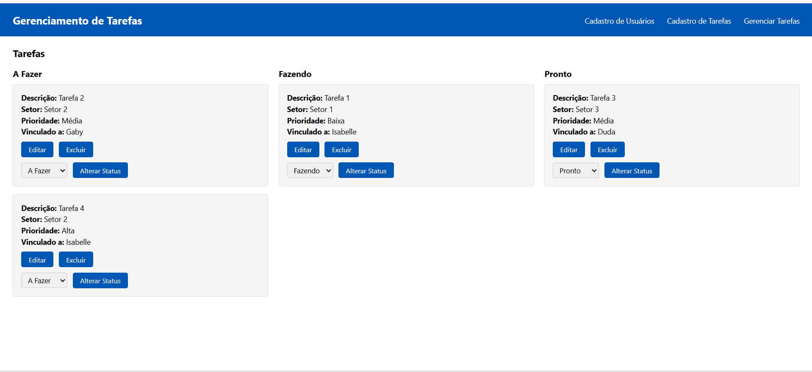
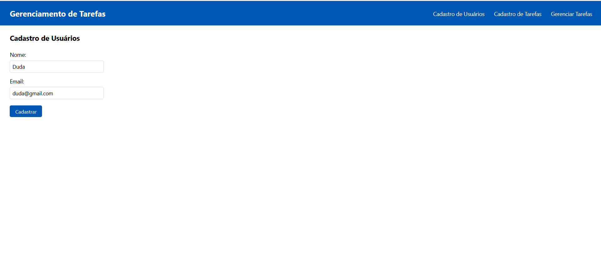
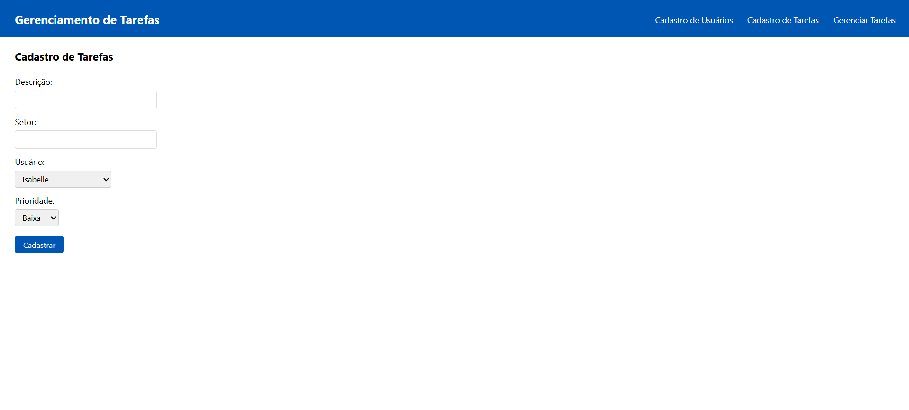
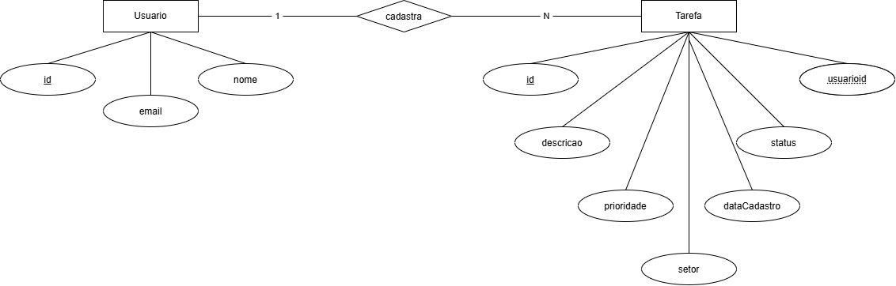

# Gerenciamento de Tarefas

Sistema desenvolvido por **Isabelle Borges** para simular a avaliação SAEP, o sistema é para gerenciamento de tarefas no formato Kanban para uma indústria alimentícia.

## Tecnologias Utilizadas
- HTML, CSS e JavaScript
- Node.js e Express
- Prisma 
- MySQL 

## Prints do Sistema

### Gerenciamento de Tarefas

### Cadastro de Usuários

### Cadastro de Tarefas

## Diagramas

### Diagrama Entidade-Relacionamento (DER)

### Diagrama de Casos de Uso

